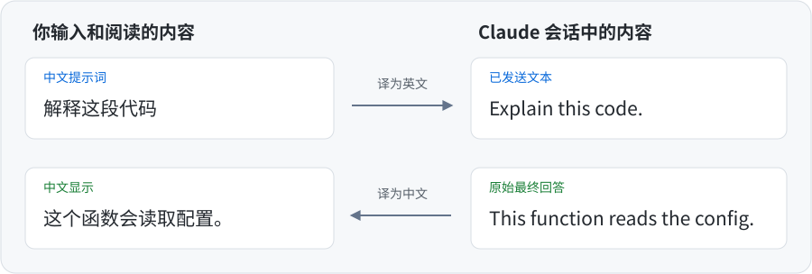
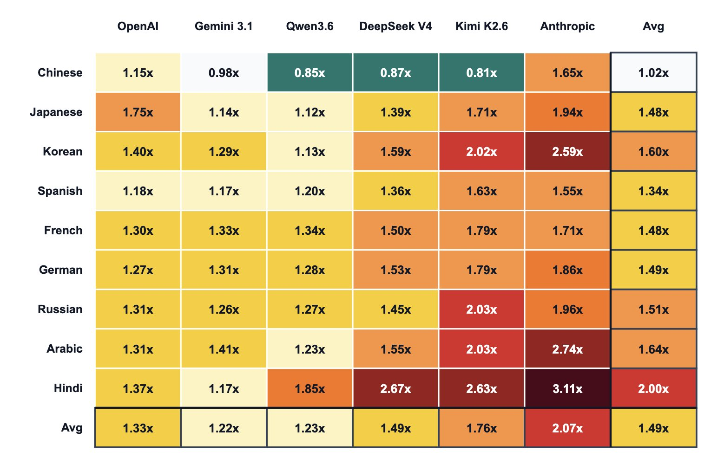

<div align="center">

# Bilingual View — Claude Code 中英双语翻译插件

**中文输入，中文阅读，随时核对原文。**

Claude Code 的双语翻译插件（Mod）。用中文提问，自动译成英文发送；<br>
用中文阅读回答，需要时切回原文。

A Chinese-English translation plugin (Mod) for Claude Code.<br>
Write prompts in Chinese, send them in English, and read replies in Chinese. Switch to the original text anytime.

[为什么需要它](#为什么需要它) · [快速开始](#快速开始) · [日常使用](#日常使用) · [常见问题](#常见问题) · [完整指南](USAGE.md)

</div>



<p align="center"><sub>纯自然语言的翻译示例，实际措辞由你选择的翻译模型决定。</sub></p>

- **用中文交流**：中文提示词和提问对话框中自行输入的中文回答会先译成英文；Claude 的英文回答可显示中文译文。
- **译好再发送**：需要翻译的输入，译文通过检查才提交；失败时不会自动改发中文原文。
- **随时对照原文**：查看提示词实际发送的版本，或切回 Claude 的原始回答。
- **自选翻译服务**：使用兼容 OpenAI Chat Completions 接口的服务，不改变 Claude 会话使用的模型。

> 命令、思考过程和普通工具输出不翻译；代码、路径等内容保持原样。详见[翻译范围](#翻译范围)。

## 为什么需要它

### 1 · 你懂的

### 2 · 更省 token

<p align="center">
  <a href="assets/token-count-by-language.jpg">
    
  </a>
</p>

<p align="center"><sub>点击图片查看原图。</sub></p>

上图比较了同一内容的不同语言版本，经各模型的 tokenizer 分词后，token 数相对英文版本的倍数（英文为 1×）。在这组测试中，**Anthropic（Claude）的中文 token 数约为英文的 1.65×**，也就是多约 65%。

图表来源：[Aran Komatsuzaki 的原帖](https://x.com/arankomatsuzaki/status/2049177688402022730)。

把中文提示词译成英文再发送，就是为了降低这部分输入的 token 开销，同时保留中文输入和阅读体验。实际节省量取决于文本和模型，翻译服务本身也会产生用量。

## 快速开始

你需要一个**支持 Mods 的 Claude Code 交互式终端或 Desktop 会话**，以及可用的翻译服务、模型和 API 密钥（如需）。

### 1 · 安装插件

在系统终端运行：

```sh
claude plugin marketplace add againest1/bilingual-view
claude plugin install bilingual-view@bilingual-view
```

启动新的 Claude Code 会话；已打开的终端会话也可以运行 `/reload-plugins`。输入框上方出现 **Bilingual View** 设置栏，即可继续配置。

也可以[手动安装](USAGE.md#手动安装)。

### 2 · 开启自动更新（推荐）

**建议通过 Marketplace 安装后开启自动更新，以便及时获得本 Mod 的修复和改进。** 第三方市场默认不会自动更新，需要手动开启：

1. 在 Claude Code 会话中运行 `/plugin`，打开插件管理器。
2. 切换到 **Marketplaces** 页面，选择 **bilingual-view**。
3. 选择 **Enable auto-update（启用自动更新）**。

收到更新提示后，启动新会话，或在已打开的终端会话中运行 `/reload-plugins`，即可使用新版。手动更新方式见[更新与卸载](USAGE.md#更新与卸载)。

### 3 · 配置翻译服务

点击 **Settings（设置）**，或运行 `/bilingual-view settings`。填写后按 **Enter** 保存；从列表选择会立即生效：

| 设置项 | 填写内容 |
| --- | --- |
| **Provider URL** | 服务的 API 基础地址，例如 `https://provider.example/v1`。也支持完整的 `/chat/completions` 地址，不要填写 `/models` 地址。 |
| **API key** | 服务要求的密钥；无需身份验证时可不填。 |
| **Model ID** | 输入翻译模型标识，或点击 **Fetch models** 从列表选择。 |

需要翻译的文本会发送到这个服务。模型列表不可用时，可直接填写 Model ID。

保存后，可在输入框上方的设置栏核对翻译模型和思考强度，例如 `Bilingual View · my-model(low)`。

默认使用 `low` [思考强度](USAGE.md#设置思考强度)。若服务不支持此参数，可在 **Effort** 中选择 **Provider default（服务默认）**。

API key 由 Claude 保存；输入时可见，保存后只显示是否已设置。更多说明见[配置指南](USAGE.md#配置)。

### 4 · 开始使用

点击 **Test connection（测试连接）**，在设置页确认示例翻译成功。该请求发送到你配置的翻译服务，不会成为 Claude 会话中的消息。

翻译默认开启。确认设置栏为 **On** 后，像平常一样[输入中文提示词](USAGE.md#发送中文提示词)：翻译成功并通过检查后，英文译文会提交给 Claude，界面保留你的中文原文供你阅读。若翻译失败，本次输入不会提交，修正设置或重试即可。

## 日常使用

| 你想做什么 | 操作 |
| --- | --- |
| [核对提示词实际发送的内容](USAGE.md#查看已发送文本和原始回答) | 在已翻译的用户消息下方点击 **View sent text（查看已发送文本）**。 |
| 查看 Claude 的原始回答 | 在已翻译的最终回答下方点击 **View original（查看原文）**。 |
| 切换回中文 | 点击 **Show Chinese（显示中文）**。 |
| 暂停或恢复翻译 | 点击设置栏的 **On/Off**，或运行 `/bilingual-view off` / `/bilingual-view on`。 |
| 调整翻译模型的思考强度 | 在 **Settings** 中选择 **Effort**，详见[档位说明](USAGE.md#设置思考强度)。 |
| 检查设置与连接 | `/bilingual-view status` 查看设置；`/bilingual-view check` 发送示例翻译请求。 |
| 查看长文本翻译用时 | 运行 `/bilingual-view speed`，按[长文测速建议](USAGE.md#测试翻译速度)优先选择 15 秒内返回的组合。 |

**关闭翻译后，输入会按原样提交，消息也会显示原文。** 重新开启不会补译已经发送给 Claude 的中文。

## 翻译范围

| 内容 | 会发生什么 |
| --- | --- |
| 普通中文提示词、`AskUserQuestion` 中自行输入的中文回答 | 开启翻译时，自然语言部分先译为英文再提交。 |
| 支持的英文用户消息、主会话中的英文最终回答 | 可生成中文译文用于显示；已有中文的自然语言文本（包括中英混合消息）直接显示。 |
| `AskUserQuestion` 的问题和选项描述 | 可显示中文译文；选项名称保留原文，中文翻译附在选项描述中。 |
| `/` 斜杠命令及参数、`!` Shell 命令、选中的选项 | 原样提交，其中的中文不会被翻译。 |
| 代码（含缩进代码块）、路径、链接、符合保留规则的引号文本等 | 翻译时保持原样，包括其中的中文。 |
| 已有会话历史、文件、项目指令、工具结果及附件 | 不会被改写为英文。思考过程、中间回复和子代理消息也不翻译显示。 |

例如，`/statusline 加入 sessionID` 会原样提交；`将按钮文字改为“提交”` 会翻译指令，但保留 `“提交”`。

「译好再发送」依靠[发送前的翻译检查](USAGE.md#发送前的翻译检查)：**未配置服务、翻译失败或译文中仍残留本应翻译的中文，都会阻止提交**。这项检查只适用于需要翻译的输入。上表中原样提交的内容不受限制。显示译文不会改写会话历史，也不强制 Claude 用英文回答。

完整的输入来源、文本保留和显示规则见[输入翻译范围](USAGE.md#输入翻译范围)与[中文显示范围](USAGE.md#中文显示范围)。

## 常见问题

<details>
<summary><strong>安装后看不到设置栏？</strong></summary>

先确认 Claude 宿主支持 Mods。在 `/plugin` → **Installed** 中确认 `bilingual-view@bilingual-view` 已安装并启用，再启动新会话，或在终端会话中运行 `/reload-plugins`。手动安装请核对[安装目录](USAGE.md#手动安装)。

</details>

<details>
<summary><strong>翻译失败，或模型列表返回 404？</strong></summary>

用 `/bilingual-view check` 检查 URL、密钥和模型。Provider URL 应包含服务要求的 API 路径前缀；服务没有模型列表接口时，直接填写 Model ID。

**单次翻译请求的超时时间为 30 秒（30s）。** 连接测试通过后，长文本翻译仍可能超时。可用 `/bilingual-view speed` [测试长文本翻译速度](USAGE.md#测试翻译速度)；遇到超时可重试或换用响应更快的翻译模型。

输入翻译失败时不会提交。显示翻译失败时仍可阅读原文，并点击 **Retry translation（重试翻译）**；提问对话框已关闭时，可在聊天记录中重试。详见[失败处理](USAGE.md#翻译失败时的处理)。

</details>

<details>
<summary><strong>为什么 Claude 仍收到了中文，或部分回答没有翻译？</strong></summary>

翻译覆盖的是特定输入和显示内容。命令、保留文本及其他上下文可能含中文；中英混合的自然语言消息、思考过程和普通工具结果不会自动翻译。可用 **View sent text** 核对已翻译提示词实际提交的版本，再对照[翻译范围](#翻译范围)。

</details>

<details>
<summary><strong>中文原文和译文保存在哪里？</strong></summary>

保存在本机的 `~/.claude/bilingual-view/cache/`，与 Claude 会话历史分开。每个会话最多 4 MiB，达到上限时较早的记录可能被移除。更新和卸载插件都不会主动清除缓存。

删除缓存会丢失已保存的中文原文；重新翻译无法还原最初的准确措辞。同一会话请勿同时在多个 Claude Code 实例中使用。详见[数据与翻译缓存](USAGE.md#数据与翻译缓存)。

</details>

## 更多说明

[完整使用指南](USAGE.md) · [问题反馈与诊断](USAGE.md#问题反馈与诊断) · [更新与卸载](USAGE.md#更新与卸载) · [清理翻译缓存](USAGE.md#清理翻译缓存) · [全部命令](USAGE.md#bilingual-view-命令)

## 许可证

本项目采用 [MIT License](LICENSE)。
